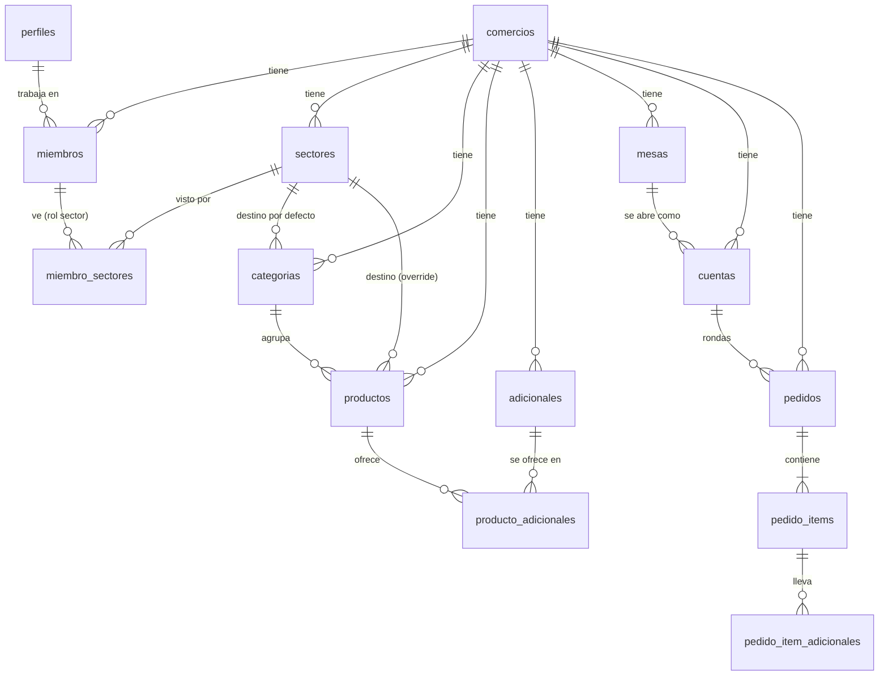
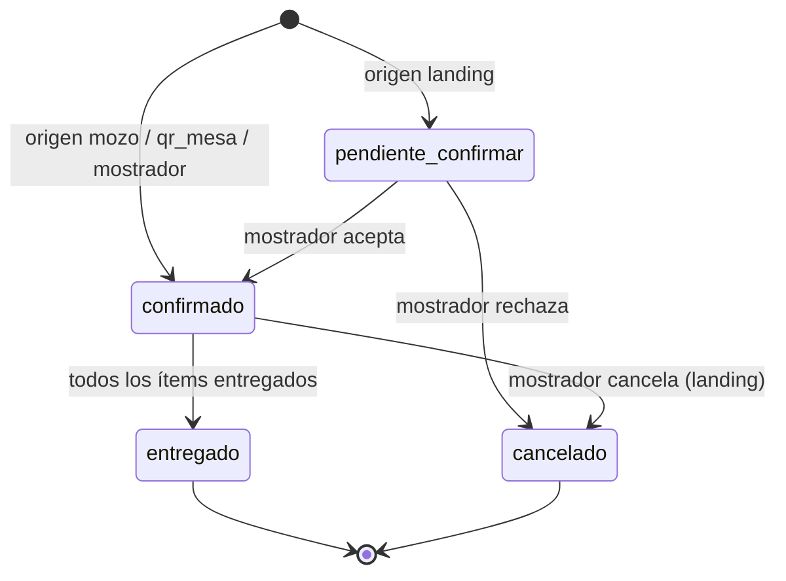

# Esquema de datos — SaaS gastronómico (Plan 1)

Contexto para desarrolladores y asistentes de IA. La fuente de verdad del esquema son las migraciones en `supabase/migrations/` (Supabase CLI) — ver "Cómo cambiar el esquema" más abajo. `docs/schema-inicial.sql` es una foto histórica de antes de migrar a este flujo (hasta el sprint 3, cuando el SQL se corría a mano en el editor de Supabase); queda solo de referencia, no se mantiene al día.

## Producto en una línea

App web multi-comercio (SaaS) para bares, restós y take away. Organiza pedidos y comandas. **No maneja pagos ni facturación.**

## Stack

- Next.js (App Router) + TypeScript
- Supabase: Postgres, Auth, Realtime, Row Level Security (RLS)
- Vercel (hosting)

## Cómo cambiar el esquema

Desde el sprint 3, todo cambio de base pasa por una migración de Supabase CLI — nunca más SQL suelto pegado a mano en el editor de Supabase (así el repo y la base nunca se desincronizan).

1. `npx supabase migration new <nombre-descriptivo>` — crea un archivo vacío y con timestamp en `supabase/migrations/`.
2. Escribir el SQL del cambio ahí adentro (y nada más que ese cambio: una migración, un propósito).
3. `npx supabase db push` — la aplica contra el proyecto de Supabase real. Este paso lo corre la persona, no el asistente.

`supabase/migrations/` es la fuente de verdad del esquema. Antes de este flujo se armaba a mano `docs/schema-inicial.sql` (ver la nota al principio de ese archivo) — queda como referencia histórica, no se vuelve a tocar.

## Reglas de oro

1. **Toda tabla de negocio lleva `comercio_id`.** Las políticas RLS filtran por ahí: un comercio nunca ve datos de otro.
2. **No se borra, se desactiva.** Productos, adicionales, mesas y usuarios usan `activo = false`. Los pedidos viejos siguen intactos.
3. **Los pedidos guardan copias** de nombre, precio y sector de productos y adicionales. Cambiar la carta no altera el historial.
4. **El plan del comercio decide qué se ve y qué se permite.** No se mueven ni borran datos al cambiar de plan.
5. **No hay pagos online.** Los comercios los crean los admins (nosotros) y activan/suspenden el plan a mano.
6. **Toda función nueva en el esquema `public` revoca `EXECUTE` de `PUBLIC` y de `anon` explícitamente.** Ver "Funciones nuevas" más abajo.

### Funciones nuevas

Postgres otorga `EXECUTE` a `PUBLIC` automáticamente al crear una función (`CREATE FUNCTION`), salvo que se revoque a mano — y `PUBLIC` no es "el rol `anon`", es un pseudo-rol que agrupa a *todos* los roles, `anon` y `authenticated` incluidos. Por eso revocar (o simplemente no otorgar) a `anon`/`authenticated` puntualmente **no alcanza**: si nunca se corre el `revoke`, el permiso les sigue llegando por `PUBLIC` igual.

Regla: toda función nueva en `public` lleva, en su misma migración e inmediatamente después de su definición (`create or replace function ... end $$;`), este patrón:

```sql
revoke execute on function nombre_funcion(tipos, de, los, argumentos) from public, anon;
grant execute on function nombre_funcion(tipos, de, los, argumentos) to authenticated;
-- + `, anon` en el grant de arriba únicamente si la función es parte de la
-- API pública (piensa: se llama desde una pantalla sin sesión, como la
-- landing o el QR de mesa — hoy son `carta_publica`, `crear_pedido_landing`
-- y `seguimiento_pedido`).
```

- Casi ninguna función necesita `anon`: la mayoría solo las llama la app ya logueada (rol `authenticated`), o las invoca otra función/trigger/policy dentro de una transacción de un usuario logueado.
- Las funciones `security definer` (la mayoría acá) igual necesitan que quien las invoca tenga `EXECUTE`: `security definer` cambia con qué permisos corre el *cuerpo* de la función una vez adentro, no quién puede *llamarla* desde afuera.
- El `revoke` explícito de `anon` (además de `public`) es redundante en los hechos — revocar de `PUBLIC` ya le saca el acceso heredado — pero se deja igual de explícito, a propósito, para que quede a la vista sin tener que razonar la cadena de herencia cada vez.
- Un `EXECUTE` otorgado a `authenticated` no es "solo para dueños": lo tiene *cualquier* sesión logueada de *cualquier* comercio, cualquier rol. Si la función responde algo que no debería ver cualquier miembro de cualquier comercio (ver `usuario_disponible` más abajo, que consulta a través de todos los comercios), el candado real tiene que ir *adentro* de la función (un chequeo con `raise exception` si no corresponde), no en el grant.
- Esta regla se sumó en el sprint 3 y ya se aplicó retroactivamente a todas las funciones existentes a esa fecha (helpers de permisos, triggers, `carta_publica`, `crear_pedido_landing`, etc.), no solo a las nuevas del sprint. Cualquier función que se agregue de acá en adelante también tiene que llevarla.
- **Ojo con `authenticated`**: Supabase le da `EXECUTE` *directo* (no a través de `PUBLIC`) a toda función nueva del esquema `public`. Una función de uso interno — que solo llaman otras funciones `security definer`, como `plazos_seguimiento` o `motivo_estado_pedido` — tiene que revocárselo explícito: `revoke execute on function … from public, anon, authenticated;`.
- Los triggers (`crear_perfil_nuevo_usuario`, `asignar_numero_pedido`, `validar_limite_usuarios`, etc.) llevan el `revoke` pero **sin** `grant` a ningún rol: nadie los invoca directo, el motor los dispara solo al ocurrir el evento (`insert`/`update` de la tabla), y eso no requiere `EXECUTE` de quien dispara el evento — revocar `PUBLIC` no rompe el trigger.

## Planes

| Plan | Take away / delivery | Salón (mesas, mozos, QR) |
| --- | --- | --- |
| `take_away` | Sí | No |
| `salon` | No | Sí |
| `completo` | Sí | Sí |

- Todos incluyen: roles, carta, adicionales, sectores y pantallas por sector.
- Límite de usuarios activos: **10 por defecto** (`comercios.limite_usuarios`). Los admins lo suben a 15/20 si el local paga el extra.

### Cambio de plan (bajar)

- **Pierde salón:** mesas e historial quedan ocultos. El admin no puede cambiar el plan si hay `cuentas` abiertas.
- **Pierde take away:** la landing muestra "no disponible". El admin no puede cambiar el plan si hay pedidos `pendiente_confirmar`.
- **Roles que ya no aplican** (ej. `mozo` en plan `take_away`): no pueden entrar y **no cuentan** para el límite.
- **Baja del límite de usuarios:** no se desactiva a nadie automáticamente; el dueño no puede crear nuevos hasta quedar por debajo.
- Si el local vuelve a subir de plan, recupera todo tal cual.

### Comercio suspendido

`comercios.estado = 'suspendido'` → sus usuarios no acceden a datos (RLS) y la app muestra un aviso. La landing pública muestra "no disponible".

## Roles

| Rol | Qué hace |
| --- | --- |
| `duenio` | Todo en su comercio: carta, mesas, usuarios, pedidos |
| `mostrador` | Confirma/rechaza pedidos de la landing, edita y cancela pedidos, entrega take away |
| `mozo` | Abre/cierra mesas, carga rondas, escanea QR, marca ítems entregados |
| `sector` | Ve la pantalla y cambia el estado de los ítems de los sectores que tiene asignados |

- Los **admins** (`perfiles.es_admin`) son del equipo del producto, no de un comercio. Ven y gestionan todo desde el panel de administrador.
- Los admins crean el comercio y el usuario dueño. El dueño crea a su personal.
- El dueño gestiona a su personal desde `/app/usuarios`: alta (mostrador, mozo o sector), edición de rol/sectores/estado, reseteo de contraseña. Nunca puede asignar el rol `duenio` desde ahí (ni al crear ni al editar) ni editarse o desactivarse a sí mismo — siempre queda exactamente un dueño activo por comercio (índice único parcial sobre `miembros (comercio_id) where rol = 'duenio'`). El nombre de un miembro (columna `nombre` en `perfiles`) lo actualiza la función `actualizar_nombre_miembro`, que valida `tiene_rol` adentro: `perfiles` no tiene una policy de UPDATE para "soy dueño de esta persona en algún comercio" a propósito, es una tabla sensible (tiene `es_admin`).
- Se permite compartir una cuenta entre dispositivos (ej. una cuenta de cocina en 2 tablets). Los mozos conviene que tengan cuenta propia para saber quién atendió cada mesa. No hay control de sesiones simultáneas.
- Un rol `sector` no ve todos los sectores por defecto: cada miembro se vincula a los sectores concretos que le tocan (`miembro_sectores`), así que "Juan cocina, María atiende la barra" son dos miembros con rol `sector` cada uno con su propia asignación. El dueño sí ve todos los sectores activos del comercio, sin necesidad de asignación explícita.
- `cocina` y `barra` existían como roles separados y quedaron obsoletos (reemplazados por `sector` + `miembro_sectores`, ver "Tablas"); el enum los conserva por limitación de Postgres pero no se usan más.

### Identificación del personal

- El **dueño** entra con su email real: es el titular del servicio y tiene que poder recuperar el acceso por su cuenta.
- El **personal** (mostrador, mozo, sector) entra con un **nombre de usuario** (`perfiles.usuario`), sin email: mucha gente en un local no tiene mail o no lo recuerda, y pedirlo en el alta es fricción innecesaria.
  - Se sugiere solo al crear, a partir del nombre de la persona y el slug del comercio (ej. "Juan Pérez" en `bar-demo` → `juan.bardemo`), y es editable antes de guardar.
  - **No se puede cambiar una vez creado** — mismo criterio que el slug de un comercio: cambiarlo rompería la referencia de con qué credencial entra esa persona.
  - Formato `^[a-z0-9._]{3,30}$` (check de la columna) y único en **todo el sistema**, no por comercio: dos comercios no pueden tener cada uno un `juan`. Se valida contra la función `usuario_disponible` (security definer) porque la policy `perfiles_personal` acota lo que un dueño ve a su propio comercio — una consulta común daría "libre" un nombre que ya usa el personal de otro comercio. Esa misma necesidad de mirar todo el sistema es lo que obliga a `usuario_disponible` a autorizar por dentro (exige ser dueño activo de algún comercio, no alcanza con `authenticated`): quien la llama puede, en los hechos, confirmar si un nombre de usuario existe en cualquier comercio, así que se acota a quienes ya son dueños reales — no a cualquier cuenta de personal — para no convertirla en una herramienta de enumeración abierta. El riesgo residual (un dueño real probando nombres de otros comercios) se acepta: es inherente a que la unicidad sea global, y el dato que se filtra es apenas un booleano, no datos de la cuenta.
- Supabase Auth igual exige un email por cuenta: al personal se le arma uno interno (`{usuario}@usuarios.local`, dominio centralizado en `src/lib/usuarios/email-interno.ts`) solo para satisfacer esa exigencia. **Nunca se muestra en la interfaz** — es un detalle de implementación, no una credencial que use ni conozca nadie.
- El login (`/login`) acepta ambos en el mismo campo de texto: si lo tipeado tiene `@` se usa tal cual como email (dueño/admin); si no, se arma el email interno a partir de eso (personal). No hay ambigüedad posible entre los dos casos porque el formato de `usuario` nunca incluye `@`.
- La contraseña, tanto al crear como al resetear, la puede escribir el dueño (mínimo 6 caracteres — el personal la tipea en una tablet compartida, más largo es fricción sin ganancia real acá) o generarla el sistema (bastante más fuerte, ~80 bits). La generada se muestra una sola vez para que el dueño se la pase al empleado; no se guarda en ningún lado más que esa respuesta.
- El alta de comercios (`/admin/comercios/nuevo`) no cambia: el dueño se sigue creando con email real y contraseña propia, sin nombre de usuario.

## Diagrama



## Tablas

### Base (sprint 1)

**`comercios`**: `id`, `nombre`, `slug` (único, para URLs: `/garage-grill`; `admin`, `app`, `login` y `api` están reservados porque son rutas de la app), `plan`, `estado` (`activo` | `suspendido`), `limite_usuarios` (10), `zona_horaria` (`America/Argentina/Buenos_Aires`), `hora_corte` (06:00), `whatsapp` (solo dígitos, con código de país y sin "+", como lo pide wa.me — ej. `5491122334455`; lo carga el admin en `/admin/comercios/[id]`. Sin número, la landing no toma pedidos: es el único contacto con el cliente, ver "Landing pública"), `creado_en`.

**`perfiles`**: `id` (= `auth.users.id`), `nombre`, `email`, `usuario` (nombre de usuario del personal sin email real, único en todo el sistema, ver "Identificación del personal"), `es_admin`, `creado_en`.

**`miembros`**: `id`, `comercio_id`, `perfil_id`, `rol`, `activo`, `creado_en`. Único por (`comercio_id`, `perfil_id`). Una persona puede estar en varios comercios.

### Carta (sprint 2)

**`sectores`**: `id`, `comercio_id`, `nombre` (libre: "Cocina", "Barra", "Parrilla", lo que haga falta), `orden`, `activo`. Todo comercio nace con "Cocina".

**`miembro_sectores`**: (`comercio_id`, `miembro_id`, `sector_id`), PK compuesta por `miembro_id` + `sector_id`. Qué sectores puede ver un miembro con rol `sector`. El dueño no necesita filas acá: ve todos los sectores activos igual.

**`categorias`**: `id`, `comercio_id`, `nombre`, `sector_id` (destino por defecto de sus productos), `orden`, `activo`.

**`productos`**: `id`, `comercio_id`, `categoria_id`, `nombre`, `descripcion`, `precio`, `imagen_url`, `sector_id`, `sin_stock`, `activo`, `orden`.

- `sin_stock = true` → se muestra en gris con "Sin stock" y no se puede pedir.
- `activo = false` → no se muestra (ver "Disponibilidad efectiva" más abajo: no alcanza con este campo solo).
- `sector_id`: la columna existe y la siguen usando las copias en `pedido_items` (a qué pantalla va cada ítem) y `crear_pedido_landing`, pero **la interfaz de administración del comercio siempre la deja en `null`** al crear o editar un producto. Decisión de negocio: un producto se prepara siempre en el sector de su categoría; si un local necesita que algo salga de otro sector, crea una categoría aparte para eso en vez de pisarle el sector a un producto puntual. Si en algún momento se necesita volver a permitir un sector propio por producto, la columna ya está lista. Mientras tanto, el "sector efectivo" de un producto es siempre `coalesce(productos.sector_id, categorias.sector_id)` — todo el código que decide disponibilidad calcula por ahí, nunca asume que es directamente el de la categoría.

**`adicionales`**: `id`, `comercio_id`, `nombre` ("Extra cheddar", "Sin cebolla"), `precio_extra` (0 si es gratis), `activo`. Se crean una vez y se reutilizan.

**`producto_adicionales`**: (`producto_id`, `adicional_id`). Qué adicionales ofrece cada producto.

Futuro (no Plan 1): grupos de adicionales con elección única ("Punto: jugoso / a punto / cocido").

### Disponibilidad efectiva (sector → categoría → producto → adicional)

**Regla:** un sector, categoría o producto solo cuenta como disponible si **todos** los niveles de los que depende están activos — no alcanza con que el nivel propio lo esté. Ningún nivel se auto-desactiva en cascada al apagar el de arriba (a diferencia de zonas → mesas, ver más abajo): cada función/pantalla calcula "¿está efectivamente disponible?" mirando toda la cadena, sin reescribir `activo` de nada.

Para el dueño: *"Si apagás un sector, se apaga todo lo que cuelga de él — sus categorías, sus productos, y la posibilidad de que alguien los pida — sin que tengas que tocar cada cosa una por una; para prenderlas de nuevo alcanza con prender el sector, todo lo demás vuelve a aparecer tal como lo dejaste."*

- **Al cliente (landing y QR):** `carta_publica` filtra categorías por `categorias.activo` y el `activo` de su propio sector (`categorias.sector_id`), y productos por `productos.activo` y el `activo` de su sector efectivo. `crear_pedido_landing` valida esa misma cadena completa (producto, su categoría, su sector efectivo) antes de aceptar un ítem — antes solo miraba `productos.activo` y `sin_stock`, así que un producto con la categoría o el sector apagados igual se podía pedir.
- **En administración:** todo sigue visible siempre (activo o no), para poder reactivarlo — pero cada listado marca el estado de los niveles de arriba, no solo el propio (ej: una categoría activa con su sector inactivo se marca "Sector inactivo" en `/app/carta/categorias`, aunque ella misma no se toque).
- **Pedidos ya existentes:** no se alteran. `pedido_items`/`pedido_item_adicionales` guardan copias de nombre, precio y sector en el momento del pedido (regla de oro #3) — desactivar algo después no cambia el historial.
- **`/app/sector/[id]`:** a propósito no bloquea el acceso a un sector inactivo (dueño o miembro asignado igual entran) — es una pantalla para ver y accionar pedidos ya tomados, no un formulario de edición, y un sector recién apagado puede tener pedidos pendientes de entregar. Solo avisa que está inactivo.

Por qué no hay cascada física acá (a diferencia de zonas → mesas): son tres niveles y potencialmente cientos de productos. Escribir `activo = false` en cascada perdería el estado que el dueño ya configuró a mano en cada uno (un producto ya inactivo por otro motivo quedaría indistinguible de "inactivo por su sector"), y al reactivar no habría forma de saber cuáles reactivar de verdad.

### Salón y pedidos (sprints 3 a 6)

**`zonas`**: `id`, `comercio_id`, `nombre` ("Salón", "Terraza"), `orden`, `activo`. Desactivar una zona arrastra `activo = false` a todas sus mesas, y reactivarla las vuelve a activar a todas (sin importar si alguna estaba desactivada aparte) — lo hace, en una sola transacción, la función `actualizar_zona_con_mesas`. No se puede desactivar la última zona activa del comercio, ni una zona con una mesa con cuenta abierta. Mientras una mesa hereda "Inactiva" de su zona, no se puede editar individualmente (`/app/mesas/[id]` redirige a `/app/mesas`).

**`mesas`**: `id`, `comercio_id`, `zona_id` (→ `zonas`), `nombre` ("Mesa 4"), `activo`, `orden`.

**`cuentas`** (mesa abierta): `id`, `comercio_id`, `mesa_id`, `mozo_id` (→ `perfiles`), `estado` (`abierta` | `cerrada`), `abierta_en`, `cerrada_en`. Solo una cuenta abierta por mesa. Se cierra con la función `cerrar_cuenta`, que solo cierra si no queda ningún ítem sin entregar (lo de pedidos cancelados no cuenta) y, si queda, devuelve cuántos hay en cada estado sin cerrar. Bloquea la fila de la cuenta mientras tanto, y `crear_pedido_mozo` toma el mismo bloqueo: una ronda cargada en el mismo instante en que se cierra la mesa nunca queda adentro de una cuenta cerrada. Cerrar no se deshace.

**`pedidos`** (un pedido take away o una ronda de mesa): `id`, `comercio_id`, `jornada` (date), `numero` (visible, reinicia por jornada), `origen` (`landing` | `mozo` | `qr_mesa` | `mostrador`), `cuenta_id` (null en take away), `estado`, `cliente_nombre`, `cliente_telefono` (opcional: la landing ya no lo pide, el contacto es el chat de WhatsApp; queda por los pedidos viejos), `modalidad` (`retiro` | `envio`), `direccion`, `nota`, `creado_por`, `creado_en`, `confirmado_en`, `cancelado_en`, `motivo_cancelacion`, `codigo_seguimiento` (solo pedidos de la landing: uuid al azar, único, que va en el link de seguimiento; el cliente lo recibe al confirmar y el mostrador lo tiene para reenviarlo — ver "Landing pública"). En los pedidos de la landing, `confirmado_en` es cuándo lo aceptó el mostrador, y desde ahí cuenta el reloj de cocina.

**`pedido_items`**: `id`, `comercio_id`, `pedido_id`, `producto_id`, `nombre` (copia), `categoria_nombre` (copia: muchos productos se llaman solo por su variante, "Simple", y sin la categoría la cocina no sabe si es un lomito o una hamburguesa), `precio_unitario` (copia), `cantidad`, `nota` ("bien cocida"), `sector_id` (copia: a qué pantalla va), `estado`, `listo_en`, `entregado_en`.

**`pedido_item_adicionales`**: `id`, `comercio_id`, `item_id`, `adicional_id`, `nombre` (copia), `precio_extra` (copia).

## Estados

### Pedido



- Las pantallas de sector solo muestran ítems de pedidos `confirmado`.
- El mostrador puede editar o cancelar un pedido aunque la cocina ya lo haya empezado. El `id` y el `numero` se mantienen.

### Ítem

`pendiente` → `en_preparacion` → `listo` → `entregado`

- El estado va **por ítem** para que cocina y barra avancen a su ritmo.
- Ejemplo: ronda con hamburguesa + fernet. La barra marca el fernet listo, el mozo lo lleva y lo marca entregado. La hamburguesa sigue en cocina. Cuando todos los ítems están `entregado`, el pedido pasa solo a `entregado` (trigger).
- En take away, el mostrador entrega todo junto cuando todos los ítems están `listo`.

## Numeración por jornada

- `numero` arranca en 1 cada **jornada**, no cada día calendario.
- Jornada = fecha local del comercio restando `hora_corte`. Con corte 06:00, un pedido de las 02:00 del sábado pertenece a la jornada del viernes.
- Lo asigna un trigger con la tabla `contadores_pedidos` (sin carreras entre inserts simultáneos).

## Canales

### Landing pública (plan `take_away` o `completo`)

- URL: `/{slug}`. Muestra la carta activa. Pide nombre, modalidad y dirección si es envío. **No pide teléfono**: el contacto con el cliente es WhatsApp, como trabajan hoy estos locales.
- No tiene opción de mesa.
- Flujo: el cliente arma el pedido → carga nombre, retiro o envío (y dirección si es envío) → revisa el resumen con el total en una confirmación → al aceptar, se crea el pedido y se le abre WhatsApp con el chat del local y el pedido ya escrito (empieza con el número de pedido en negrita, para que el mostrador lo cruce con su pantalla, y termina con el link de seguimiento, así le queda en su propio chat) → al volver al navegador ve su link de seguimiento, con el aviso de que lo guarde y de que, si lo pierde, se lo pida al local por WhatsApp. El mensaje se arma recién después de crear el pedido: el código ya existe (lo genera el mismo insert), y si no llegara no se arma ningún mensaje.
- **Sin WhatsApp cargado (`comercios.whatsapp`), el local no toma pedidos online**: no habría cómo contactar al cliente. La landing lo muestra como "no toma pedidos online" y `crear_pedido_landing` lo rechaza.
- El cliente **no** escribe en tablas directamente: usa la función `crear_pedido_landing` (security definer), que valida plan, estado del comercio, WhatsApp, disponibilidad y precios desde la base (nunca confía en precios del cliente), y también los datos del cliente con los mismos límites que la pantalla (nombre, dirección obligatoria con envío, hasta 50 líneas y 99 unidades por línea; el teléfono es opcional y, si llega, se valida): la función se puede llamar directo con la clave anónima, que es pública. Devuelve el número, el código de seguimiento, hasta cuándo puede servir el link como máximo (`vence_en`) y el detalle guardado (para armar el mensaje).
- El pedido nace `pendiente_confirmar`. Con retiro no se guarda dirección aunque llegue.
- El sistema no cobra el envío ni lo suma al total: la pantalla avisa que su costo se arregla aparte con el local. Tampoco se paga online. Los totales que ve el cliente dicen "Documento no válido como factura" (ver "Mozo").
- **Seguimiento** en `/{slug}/pedido/{codigo_seguimiento}`, sin cuenta ni login. El cliente recibe el link al confirmar; el mostrador lo tiene en su pantalla para reenviárselo. La función `seguimiento_pedido(slug, código)` devuelve el estado y el detalle (sin el teléfono del cliente ni ids internos) solo si el código existe, es de un pedido de la landing de ese mismo comercio, el comercio está activo y el link no venció. **Vencimiento**: mientras el pedido está en curso, el link anda siempre (tarde lo que tarde el local); una vez entregado o cancelado, sigue andando **2 horas** más (para ver "¡Gracias por tu pedido!" o el aviso de cancelado); y nunca más de **24 horas** desde que se hizo, para un pedido que quedó colgado. Los dos plazos están en **un solo lugar**, la función `plazos_seguimiento()`: para cambiarlos alcanza con una migración que la reemplace. Al cliente se le muestra: "El local está revisando tu pedido" (`pendiente_confirmar`), "Están preparando tu pedido" (`confirmado` con algún ítem sin terminar), "Tu pedido está listo para retirar" o "Tu pedido va en camino" (todos los ítems `listo` o `entregado`, según retiro o envío), "¡Gracias por tu pedido!" (`entregado`) y, si se canceló, que consulte por WhatsApp. Se actualiza consultando cada 10 segundos, no por Realtime (ver "Realtime").
- **Aviso "Tu pedido #N" en la landing**: vive de lo que el celular tiene guardado. La landing **no consulta** el estado del pedido (ni al entrar ni cada tanto): la abren muchos clientes a la vez y sería tráfico que se multiplica sin aportar nada. El aviso dice siempre "Tocá para ver cómo va" y lleva al seguimiento (que sí consulta, porque ahí el cliente está mirando a propósito). Se borra del celular en dos casos: cuando el cliente entra al seguimiento y el pedido ya está entregado o cancelado (o el link ya no existe), y por tiempo, como red de seguridad, a las **3 horas** de hecho el pedido (`VIGENCIA_PEDIDO_RECIENTE_MS` en `src/app/[slug]/almacen-local.ts`).

### Pedido desde la mesa con QR (plan `salon` o `completo`)

- Cada mesa tiene un QR a `/{slug}/mesa/{mesa_id}` con la carta.
- El cliente arma el pedido en su celular **sin escribir en la base**. La app genera un QR con el carrito (ids de producto, cantidades, adicionales, notas).
- El mozo lo escanea desde su app; la app valida contra la base y crea la ronda en la cuenta abierta con `origen = 'qr_mesa'`.
- Ventaja: no hay pedidos anónimos ni spam en la base.

### Mostrador (pedidos de la landing)

- Pantalla `/app/pedidos`, para dueño y mostrador, solo con plan con take away. El mostrador cae directo ahí al loguearse.
- Pestañas: **Nuevos** (pendientes), **En cocina** (aceptados con algo sin terminar) y **Listos para entregar** (aceptados con todo listo). Las rondas de salón no aparecen: tienen su circuito (mozo, cuentas).
- Cada acción es una función de la base que valida adentro rol (dueño o mostrador; el mozo no), estado y origen (`landing`), y bloquea el pedido mientras trabaja: si dos personas aceptan a la vez, la segunda recibe "Este pedido ya fue aceptado".
  - `aceptar_pedido_landing`: pendiente → `confirmado`, con `confirmado_en`. Desde ese momento es una comanda más: cocina lo ve (sus ítems ya tienen sector desde que se crearon), con nombre del cliente, retiro o envío y la aclaración general, y su reloj cuenta desde la aceptación.
  - `cambiar_item_pedido_landing`: solo **antes** de aceptar — cambia la cantidad de un ítem o lo saca (cantidad 0). El último ítem no se puede sacar: para eso está rechazar. Una vez aceptado no se edita más: los cambios se hablan con el cliente.
  - `cancelar_pedido_landing`: rechazar (pendiente) o cancelar (ya aceptado), en cualquier momento antes de entregado. Sin motivo por ahora.
  - `entregar_pedido_landing`: todo junto, cuando cocina terminó todo: marca los ítems `entregado` (con hora) y el trigger cierra el pedido, igual que en salón.
- "Copiar link para el cliente" copia un mensaje con el link de seguimiento, para pegarlo en el chat de WhatsApp del cliente.

### Mozo

- Abre la cuenta de la mesa, carga rondas (incluso de un solo producto), marca ítems entregados y cierra la mesa.
- El resumen con el total que se muestra antes de cerrar la mesa (`/app/salon/[id]`) dice "Documento no válido como factura": el sistema no factura ni cobra. Cualquier otro lugar que muestre un total al cliente tiene que decir lo mismo.

## Realtime

- Pantallas de sector: suscripción a `pedido_items` del sector, y a los cambios de `pedidos` del comercio (el mostrador acepta o cancela cambiando el pedido, no sus ítems).
- Mostrador: suscripción a `pedidos` y `pedido_items` del comercio. Mozos: `pedido_items` y `cuentas`.
- El seguimiento del cliente (landing) **no** usa Realtime: es anónimo (RLS no le manda ningún cambio, y abrírselo expondría pedidos ajenos) y cada cliente mirando su pedido gastaría una conexión de las del local. Consulta cada 10 segundos mientras la pantalla está a la vista.
- Cada pantalla abierta es una conexión. Supabase Pro incluye 500 simultáneas (~50-80 locales activos).

## Fuera del Plan 1

Promociones (2x1), grupos de adicionales, impresión de comandas, caja/cierres/reportes, stock por cantidades, pagos online, facturación.
